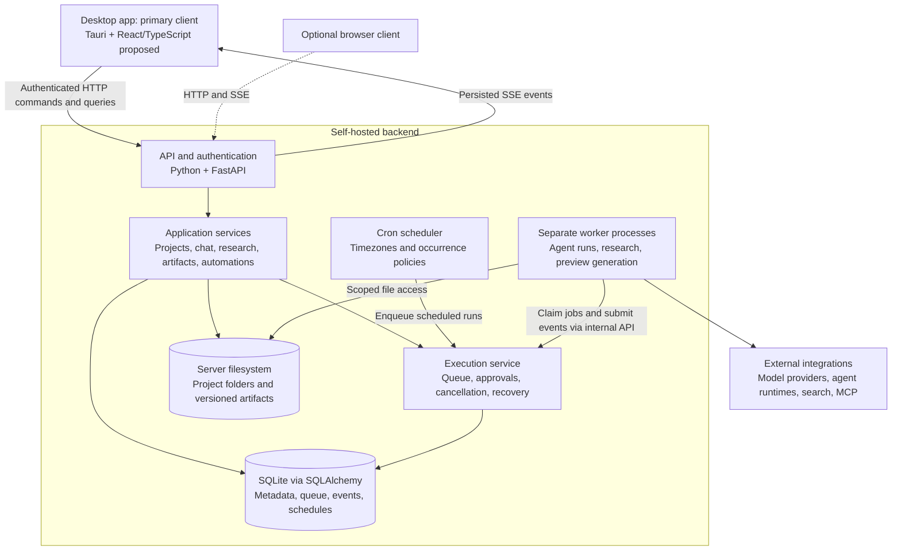

# AI Workspace Plan

Updated: 2026-10-17 (Asia/Taipei)
Status: architecture discussion; no application implementation yet.

## User direction

Build a personal self-hosted AI workspace with projects, agent chats, ordinary
chat, files, artifact previews, research, task automation, and cron scheduling.
Use Odysseus as the preferred repository-structure reference. Use the local
LabDeck project for project navigation, agent interactions, approvals, persistent
sessions, file previews, and activity presentation.

A desktop app is an explicit user requirement, alongside self-hosting. The
primary client is an installed desktop application connected to an independent
self-hosted server. Browser access is optional. Scheduled execution must not
depend on an open desktop client. Self-hosting did not replace the desktop
requirement; the earlier browser-primary interpretation was incorrect.

## Discussion history

1. Considered a desktop client backed by an independent server.
2. Proposed a TypeScript monorepo with apps and shared packages.
3. User preferred self-hosting and then explicitly preferred Odysseus structure.
4. Revised proposal to a Python backend with top-level core, routes, services,
   integrations, and deployment directories. React/TypeScript remains a frontend
   proposal, not an explicit user decision or a description of Odysseus.
5. User requested this file to track discussion and a source-based comparison.
6. User reaffirmed the desktop app requirement. Desktop is the primary client;
   self-hosting describes the backend deployment, not a browser-only product.

## Proposed architecture

- Installed desktop client connected to a self-hosted backend. Tauri with a
  narrow Rust native bridge is proposed; framework choice is not yet finalized.
- Modular monolith backend with a separate execution worker process.
- Python + FastAPI + Uvicorn backend; Pydantic request/response schemas.
- SQLAlchemy + SQLite initially; filesystem storage for projects and artifacts.
- Versioned database migrations; Alembic is a candidate, not yet selected.
- HTTP commands/queries and persisted SSE run events with reconnect cursors.
- One execution service for interactive agents, research, and automation.
- Server owns application database writes; workers claim jobs and submit events
  through an authenticated internal interface. The queue is database-backed.
- Server owns project paths and configured mounted folders. Remote client files
  require explicit upload/download; local worker pairing is future work.
- React + TypeScript frontend is proposed, bundled into the desktop app. It
  connects to the server through authenticated HTTP and SSE. Optional browser
  access can reuse the frontend. Vanilla ES modules remain an alternative.
- The desktop bridge owns native file dialogs, credential-vault integration,
  notifications, and external file opening. Business logic stays on the server.
- Closing the app disconnects the client without stopping server runs or cron.
  The server may run on the same machine or a remote self-hosted machine; local
  service startup/installation and desktop packaging remain design decisions.
- Docker Compose deployment. Initially server and worker; search and vector
  services are optional additions whose need must be established.

## Architecture diagram

Proposed components and connections; framework choices remain provisional.
The server and workers run independently of the desktop app, either on the same
computer or on a remote self-hosted machine.



Chat requests, research tasks, and scheduled automations use the same execution
service. Workers report state through the server rather than writing application
tables directly. Closing the desktop app leaves backend jobs and cron running;
the backend host must remain available. Worker process separation alone does
not provide a security sandbox.

## Proposed repository structure

```text
ai-workspace/
  app.py                 Application composition and startup
  pyproject.toml         Backend dependencies and tooling
  core/                  Configuration, auth, database, events, storage
  routes/                HTTP endpoints, validation, event streams
  services/
    projects/
    conversations/
    execution/           Queue, run lifecycle, approvals, recovery
    research/            Investigations, sources, findings, reports
    artifacts/           Versions, extraction, preview processing
    automations/         Definitions, cron, schedule occurrences
  integrations/
    providers/           Model endpoint adapters
    runtimes/            Agent runtime adapters
    search/
  tools/                 Agent-callable adapters to application services
  mcp_servers/           Workspace capabilities exposed over MCP
  frontend/              Shared client UI, proposed React/TypeScript
  desktop/               Proposed Tauri shell, Rust bridge, native packaging
  migrations/
  config/
  docker/
  scripts/
  tests/
  docs/
  .env.example
  compose.yaml
```

Routes and agent tools call services. Services use core infrastructure and
integration interfaces. Avoid feature-specific logic accumulating in core or
app.py. These directories do not imply independent microservices.

## Core records and execution rules

Records: workspace, project, conversation, message, task, run, run event,
approval, artifact/version, investigation/source/finding, automation, schedule,
and schedule occurrence.

- A task is an objective; a run is one execution attempt. Retrying creates a run.
- Persist ordered events before streaming. Desktop/browser disconnect does not
  cancel server execution.
- Track worker leases/heartbeats; reconcile interrupted work after restart.
- Do not automatically replay uncertain external side effects.
- Scope approvals to run and operation; cancellation expires pending requests.
- Start with one writing run per project. Concurrent writing needs isolation.
- Artifact versions preserve earlier outputs and producing-run provenance.
- Research stores evidence and reports outside conversation text.
- Scheduler records cron, IANA timezone, overlap, missed-run, timeout, retry,
  and execution-budget policies. Unique occurrences prevent duplicate enqueue.
- Execution is at least once; external effects need idempotency where possible.
- Unattended runs use explicit permission policies or wait for human approval.
- Worker process separation is not an OS sandbox. Define filesystem, process,
  credential, and network enforcement before enabling powerful tools.

## Reference inspection: Odysseus main

Inspected online on 2026-10-16. These are observations of fetched main-branch
files, not pinned-commit guarantees or a complete runtime audit.

Structure: app.py, core/, routes/, src/, services/, integrations/, mcp_servers/,
static/, config/, docker/, scripts/, tests/, specs/, companion/, and website/.
core contains auth/database/middleware; src contains substantial agent, model,
chat, memory, and background-job logic; services contains research/search/shell
and other feature areas. Our proposed services layout consolidates feature logic
rather than copying the split between src and services.

Verified technologies:
- Python FastAPI/Uvicorn, Pydantic, HTTPX, SQLAlchemy.
- SQLite by default; external PostgreSQL configuration and psycopg2 dependency.
- Static HTML/CSS/JavaScript, raw ES modules served by FastAPI without a frontend
  build step. It is not the React/TypeScript frontend proposed for our project.
- ChromaDB HTTP client and FastEmbed local ONNX embeddings.
- croniter, MCP Python SDK, pypdf, BeautifulSoup, Markdown and nh3 sanitization.
- bcrypt, cryptography, pyotp, pytest and pytest-asyncio.
- Compose includes application, ChromaDB, SearXNG, and ntfy services.
- app.py describes single-process operation by convention; Compose enables
  in-process pollers/tasks. Our independent durable worker is a proposed change,
  not an established property of Odysseus.

Sources:
- https://github.com/odysseus-dev/odysseus/tree/main
- https://github.com/odysseus-dev/odysseus/blob/main/requirements.txt
- https://github.com/odysseus-dev/odysseus/blob/main/app.py
- https://github.com/odysseus-dev/odysseus/blob/main/core/database.py
- https://github.com/odysseus-dev/odysseus/blob/main/docker-compose.yml
- https://github.com/odysseus-dev/odysseus/tree/main/static
- Local reference: /srv/data/repos/igvi-lab-deck/

## Delivery proposal

1. Desktop shell and server connection, project creation, authentication,
   persistence, and self-hosted server deployment.
2. One complete agent conversation with approvals, activity, files, previews,
   cancellation, and reconnection.
3. Durable background execution and interruption recovery.
4. Automation definitions, cron, and execution history.
5. Evidence-based research workflows and cited reports.
6. Bounded parallel workers and isolated worktrees where needed.

## Open decisions

- React/TypeScript frontend versus Odysseus-style vanilla ES modules.
- Desktop framework, target operating systems, installer/update strategy, and
  optional same-machine server installation. Desktop itself is required.
- First runtime/provider and direct-chat support priorities.
- Single-owner initial release versus shared multi-user workspaces.
- Worker isolation and unattended execution policy.
- Search provider; when semantic retrieval warrants vector infrastructure.
- Exact API conventions, migration tooling, dependency versions and lockfiles.
- Independent implementation versus fork/reuse; assess upstream license terms
  if copying code. Structural inspiration does not require a fork.
